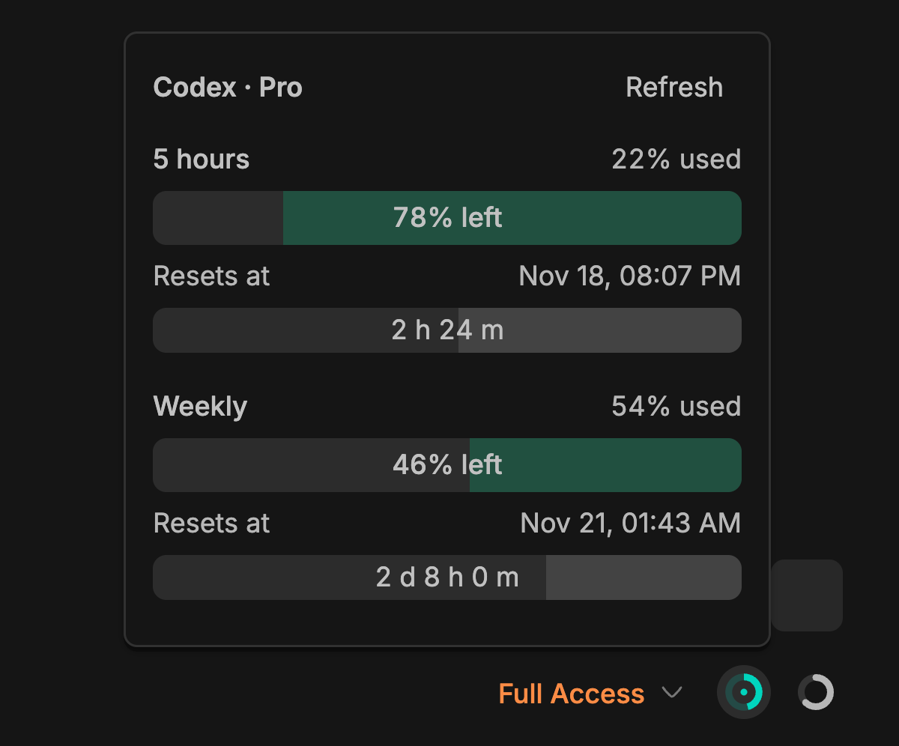

# Codex Quota

[Русский](README.ru.md)

Codex Quota is a BB plugin that shows how much of your Codex subscription quota
is left. The teal ring beside the thread’s context meter shows the lowest
remaining percentage across the quota windows reported by Codex.



## Requirements

- BB 0.49 or later with Plugin SDK 0.6.132 or later in the 0.x series.
- BB’s bundled Codex provider enabled. On the machine that runs the thread,
  Codex must be installed and signed in to a ChatGPT account with a Codex
  subscription.
- A Codex thread with the context meter visible in its composer footer.

The plugin uses your existing subscription and adds no paid service.

## Install

### From a local checkout

This works before the first public release. With Node.js, npm and the `bb` CLI
on your PATH, run these commands from the root of a local copy of this repository.
BB builds the plugin during installation and registers it from that directory.

```sh
npm ci --omit=dev --ignore-scripts
bb plugin install .
```

### From Git after the public tag

Once the repository is public and `v0.1.0` is published, install with the BB CLI.
BB uses its bundled npm for this route and requires `git` on PATH.

```sh
bb plugin install 'git:https://github.com/ai-babai/bb-plugin-codex-quota.git@^0.1.0'
```

The range tracks compatible 0.1.x tags. Use `bb plugin update codex-quota`
to apply a compatible update.

## Use the quota indicator

Open a Codex thread and hover over the teal ring beside the context meter.
The popover shows the percentage left in each reported window, such as the
five-hour and weekly limits, along with the reset time and countdown when
available. The bars drain from left to right.

Click or tap the ring to keep the popover open. With the ring focused, press
**Enter** or **Space** to open it and **Esc** to dismiss it. Use **Refresh** to
request current usage from the Codex provider. The plugin checks usage every
two minutes while the page is visible and updates the countdown every 15
seconds.

A question mark indicates unknown quota. Data becomes stale after 90 minutes.
When a reset time passes, the plugin waits for a fresh reading before showing
the ring’s fill again. If the ring is missing, check that the context meter
is visible. BB footer markup changes can affect where the ring appears.

## Change the plugin language

English is the default. In BB, open **Settings → Installed plugins**, select the
gear beside **Codex Quota**, and set **Language** to **English** or **Русский**.
The popover updates immediately, and BB saves the choice.

The CLI can also switch the plugin to Russian.

```sh
bb plugin config codex-quota set language ru
```

Use `en` to switch back to English.

## Privacy

The plugin reads subscription usage through BB’s public provider usage API
for the machine running the active Codex thread. The browser receives the plan
label, observation time, quota windows, remaining percentages and reset times.
Credential files stay untouched, and the response excludes account identifiers,
email addresses and raw provider errors.

The plugin sends no telemetry to its author. **Refresh** may prompt BB’s Codex
provider to contact its usage service. BB runs installed plugins with full trust.

## Development

The development checks use Node.js 22.13+ on the 22.x line or Node.js 24+,
npm and the `bb` CLI. From the repository root, run:

```sh
npm ci --ignore-scripts
npm run check
```

The check runs TypeScript, Vitest and the BB build, then verifies the list of
files in the package. For live development, run `bb plugin install .` once in
the checkout, then `bb plugin dev` to rebuild and reload on save.

Source entry points and release materials are listed in the [project index](INDEX.md).

## License

An independent community plugin released under the [MIT License](LICENSE).
