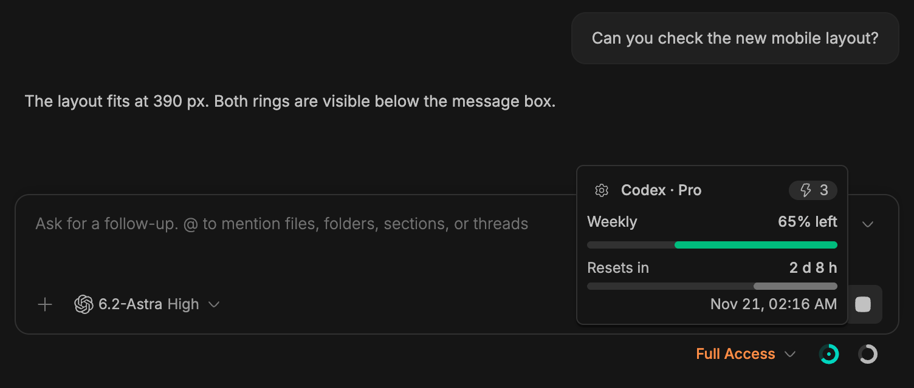
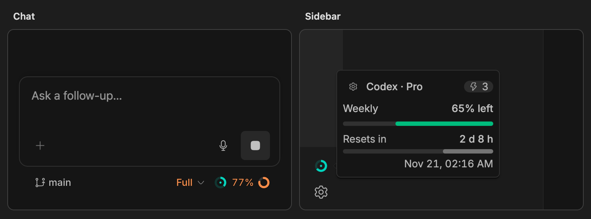
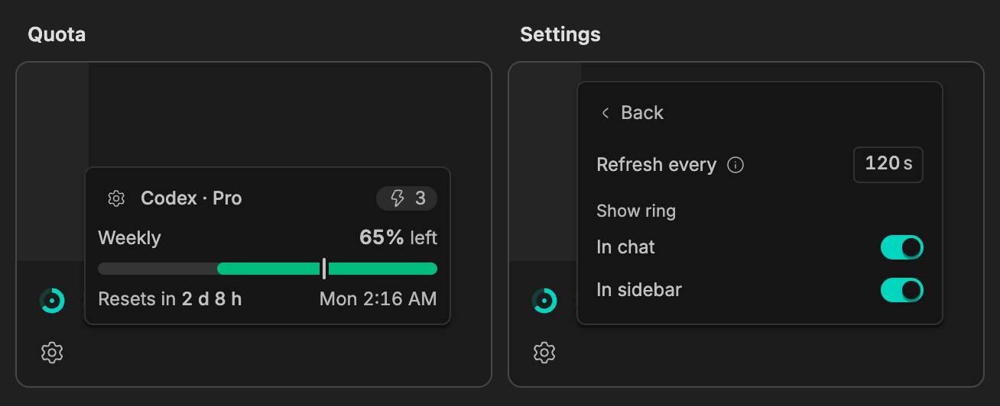

# Codex Quota for BB

[Русский](README.ru.md)

Codex Quota shows how much of your OpenAI Codex subscription quota is left and when each limit resets. Select Codex and an existing machine in a new BB chat to check your limits before sending the first message.



<details>
<summary>Compare with Plus — five-hour and weekly limits</summary>

In this example, 78% of the five-hour quota and 46% of the weekly quota remain. The ring shows the lower value, **46%**.


</details>

## Where to see your Codex limits

The teal ring sits beside the context meter in Codex chats and side chats, and above Settings in the left sidebar. A Codex side chat shows the quota for its machine even when the main chat uses another provider.

Hover over the ring to preview each reported limit, its reset time and countdown. Click the ring to close the preview, then click again to reopen it. With the ring focused, use **Enter** or **Space** to toggle it and **Esc** to close it. A **?** means quota data is missing, at least 90 minutes old, or awaiting an update after a reset.

The lightning bolt shows the number of available manual resets, including zero. It stays hidden when the count is unknown. If resets are available, hover over or tap the bolt to check their expiry dates without using a reset.

## On your phone

Tap the teal ring in the chat composer or open the left sidebar and tap the ring above Settings. Both show the remaining quota and reset time.



## Quick settings

The **Settings** gear beside the plan name opens **Refresh**, **In chat** and **In sidebar**. Select **Save** to apply changes.



Opening a Codex chat refreshes its quota once, even with the timer off. By default, quota then updates every two minutes while the page is visible. Hovering over or pressing the ring also requests fresh data by default. In **Settings → Installed plugins → Codex Quota**, you can restore either ring, change those refresh triggers, or set **Language** to **English** (default) or **Русский**.

<details>
<summary>Language and refresh interval from the CLI</summary>

```sh
bb plugin config codex-quota set language ru
bb plugin config codex-quota set refreshIntervalSeconds 300
```

Use `en` for English. The interval is in seconds, so `300` checks every five minutes and `0` turns off the timer. Set `refreshOnHover` or `refreshOnPress` to `false` to turn off that trigger.

</details>

## Installation

Requires BB 0.49+, Plugin SDK 0.6.132 or later in the 0.x series, and BB’s built-in Codex provider. On the machine running the chat, sign in to Codex CLI with a ChatGPT plan that includes Codex.

```sh
bb plugin install 'git:https://github.com/ai-babai/bb-plugin-codex-quota.git@^0.2.0'
```

For an existing 0.1.x installation, switch its tracked range to 0.2.x. BB keeps the plugin settings.

```sh
bb plugin update codex-quota --range '^0.2.0'
```

<details>
<summary>Install from a local checkout</summary>

Run these commands in the repository root.

```sh
npm ci --omit=dev --ignore-scripts
bb plugin install .
```

</details>

## Privacy

BB’s Codex provider supplies quota data. On load and refresh, the plugin reads the manual reset count from Codex CLI on the chat’s machine via `account/rateLimits/read`. After matching the accounts, the plugin sends the count and, when requested, expiry dates to the UI. Codex handles sign-in. The plugin sends no telemetry.

<details>
<summary>Development checks</summary>

Run with Node.js 22.13+ (22.x) or 24+, npm and the BB CLI.

```sh
npm ci --ignore-scripts
npm run check
```

</details>

[Add a quota collector](docs/PROVIDERS.md) · [Quality checks](docs/QUALITY.md) · [Project map](INDEX.md) · [MIT license](LICENSE)
