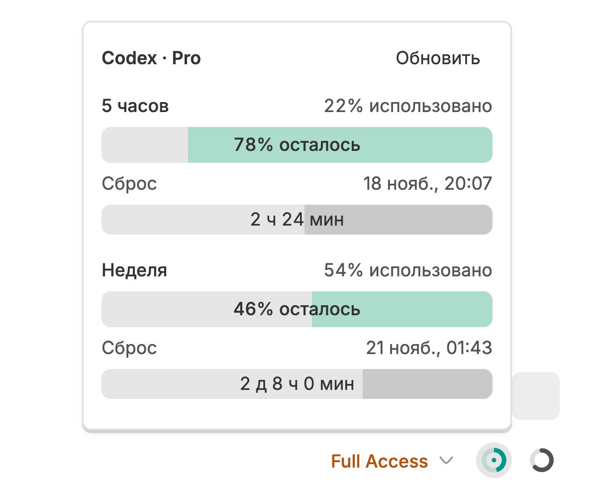

# Codex Quota

[English](README.md)

Codex Quota — плагин для BB, который показывает остаток лимитов подписки Codex.
Бирюзовое кольцо рядом с индикатором контекста показывает наименьший остаток
в процентах среди всех лимитов, которые сообщает Codex.



## Требования

- BB 0.49 или новее с Plugin SDK версии 0.6.132 или новее в ветке 0.x.
- Включённый встроенный провайдер Codex в BB. На машине, где работает чат,
  должен быть установлен Codex и выполнен вход в аккаунт ChatGPT с подпиской
  Codex.
- Чат Codex с видимым индикатором контекста под полем ввода.

Плагин использует вашу подписку. Дополнительных платежей за плагин нет.

## Установка

### Из локальной копии

Этот способ работает до первого публичного релиза. Понадобятся Node.js, npm
и команда `bb` в PATH. Команды запускаются из корня локальной копии репозитория.
BB соберёт плагин при установке и подключит его из этой папки.

```sh
npm ci --omit=dev --ignore-scripts
bb plugin install .
```

### Из Git после публикации тега

Когда репозиторий станет публичным и появится тег `v0.1.0`, плагин можно
будет установить через BB CLI. Для этого способа BB использует встроенный npm.
В PATH понадобится `git`.

```sh
bb plugin install 'git:https://github.com/ai-babai/bb-plugin-codex-quota.git@^0.1.0'
```

Этот диапазон включает совместимые версии с тегами 0.1.x. Команда
`bb plugin update codex-quota` устанавливает доступное совместимое обновление.

## Как читать индикатор

При наведении на бирюзовое кольцо рядом с индикатором контекста открывается
окно с остатком по каждому доступному лимиту, например за пять часов или за
неделю. Если провайдер передал время сброса, окно покажет его и обратный отсчёт.
Полосы убывают слева направо.

Нажатие на кольцо закрепляет окно. С клавиатуры окно открывается клавишами
**Enter** или **Пробел**, когда кольцо в фокусе, и закрывается клавишей **Esc**.
Кнопка **Обновить** запрашивает свежие данные у провайдера Codex. Пока страница
видна, плагин проверяет лимиты каждые две минуты. Обратный отсчёт обновляется
каждые 15 секунд.

Знак вопроса означает, что остаток неизвестен. Данные устаревают через 90 минут.
Когда наступает время сброса, заливка кольца появится снова после получения
свежих данных. Если кольцо пропало, стоит проверить, виден ли индикатор
контекста. Изменения в разметке нижней панели BB могут повлиять на размещение
кольца.

## Язык интерфейса плагина

По умолчанию плагин работает на английском. В BB нужная настройка находится
в разделе **Settings → Installed plugins**. Шестерёнка рядом с **Codex Quota**
открывает настройки, где в поле **Language** можно выбрать **English** или
**Русский**. Окно лимитов сразу переключится на выбранный язык, а BB сохранит
настройку.

Переключить плагин на русский можно и через CLI.

```sh
bb plugin config codex-quota set language ru
```

Код `en` возвращает английский язык.

## Приватность

Плагин получает данные о лимитах через публичный API провайдеров BB для машины,
на которой работает открытый чат Codex. В браузер передаются название тарифа,
время получения данных, периоды лимитов, проценты остатка и время сброса.
Плагин не читает файлы с учётными данными. Идентификаторы аккаунта, адреса
электронной почты и исходные сообщения об ошибках провайдера остаются за
пределами ответа.

Плагин не отправляет телеметрию автору. По кнопке **Обновить** провайдер Codex
может обратиться к своему сервису лимитов. BB запускает установленные плагины
с полным доверием.

## Разработка

Для проверок нужны Node.js 22.13+ в ветке 22.x или Node.js 24+, npm и команда
`bb`. Команды запускаются из корня репозитория.

```sh
npm ci --ignore-scripts
npm run check
```

Команда проверяет типы, запускает Vitest, собирает плагин через BB и сверяет
состав пакета. Для разработки можно один раз подключить локальную копию
командой `bb plugin install .`, а затем запустить `bb plugin dev` для
пересборки и перезагрузки при сохранении файлов.

Точки входа в код и материалы для релиза перечислены в [карте проекта](INDEX.md).

## Лицензия

Независимый плагин сообщества под [лицензией MIT](LICENSE).
