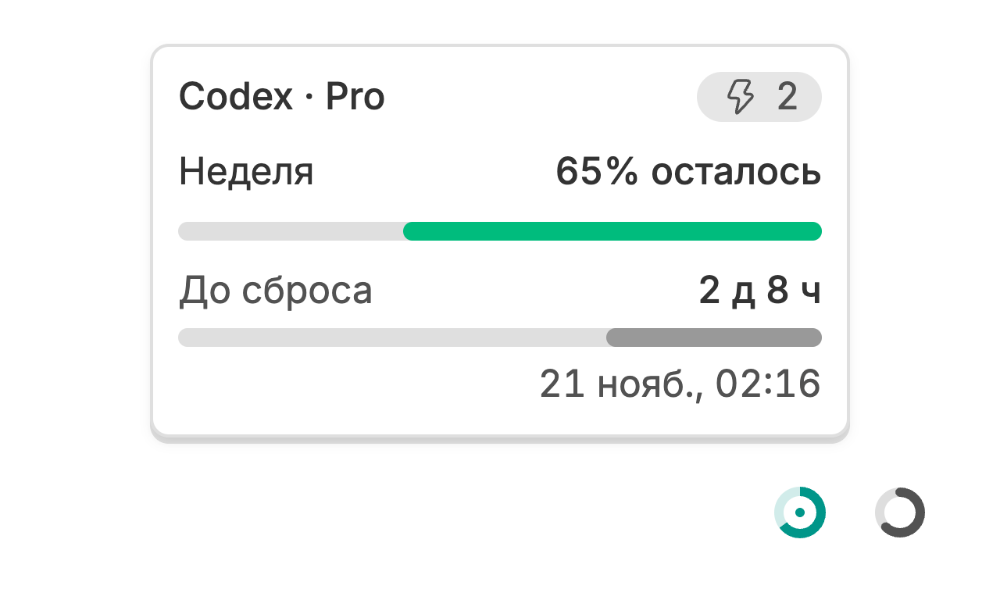
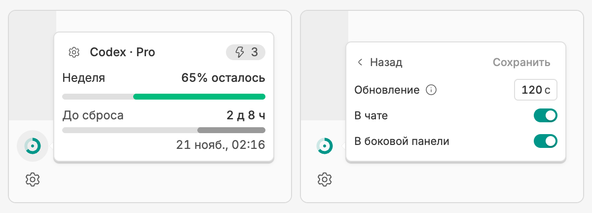

# Codex Quota для BB

[English](README.md)

Codex Quota показывает, сколько осталось от лимитов подписки OpenAI Codex и когда они сбросятся. В новом чате BB достаточно выбрать Codex и уже подключённую машину, чтобы проверить лимиты до первого сообщения.



<details>
<summary>Сравнить с Plus — лимиты на 5 часов и на неделю</summary>

В этом примере осталось 78% лимита на 5 часов и 46% недельного. Кольцо показывает меньший остаток — **46%**.


</details>

## Где посмотреть лимиты Codex

В чатах Codex, включая боковые, бирюзовое кольцо стоит рядом с индикатором контекста. В левом меню BB оно над настройками, а в узком чате на телефоне — рядом с кнопкой отправки. В боковом чате Codex видны лимиты его машины, даже если в основном чате выбран другой провайдер.

При наведении на кольцо видны остатки по лимитам, время сброса и отсчёт. Клик закрывает карточку после наведения, повторный клик открывает её. На сенсорном экране карточка открывается и закрывается касанием. Когда кольцо в фокусе, **Enter** и **Пробел** открывают и закрывают карточку, **Esc** закрывает. Знак **?** означает, что данных нет, им 90 минут или больше либо после сброса нужно обновление.

Молния показывает число доступных ручных сбросов, включая ноль. Если число неизвестно, молния скрыта. Когда сбросы доступны, курсор или касание открывает сроки их действия. Просмотр не расходует сбросы.

## Быстрые настройки

Шестерёнка **Настройки** рядом с тарифом открывает поле **Обновление** и переключатели **В чате** и **В боковой панели**. Изменения применяются кнопкой **Сохранить**.



По умолчанию лимиты обновляются каждые две минуты, пока страница видна, а также при наведении и нажатии на кольцо. В **Settings → Installed plugins → Codex Quota** можно вернуть скрытое кольцо и отключить обновление при наведении или нажатии. В поле **Language** по умолчанию стоит **English**. Чтобы сменить язык, выберите **Русский**. BB сохранит выбор.

<details>
<summary>Язык и интервал обновления через CLI</summary>

```sh
bb plugin config codex-quota set language ru
bb plugin config codex-quota set refreshIntervalSeconds 300
```

Значение `en` включает английский. Интервал `300` секунд означает проверку раз в пять минут, `0` отключает таймер. Параметры `refreshOnHover` и `refreshOnPress` можно отключить по отдельности значением `false`.

</details>

## Установка в BB

Нужны BB 0.49+, Plugin SDK от 0.6.132 в ветке 0.x и встроенный провайдер Codex. На машине чата нужен вход в Codex CLI через аккаунт ChatGPT с доступом к Codex.

```sh
bb plugin install 'git:https://github.com/ai-babai/bb-plugin-codex-quota.git@^0.2.0'
```

Для обновления версии из Git есть команда `bb plugin update codex-quota`.

<details>
<summary>Установка из локальной копии</summary>

Команды запускаются из корня репозитория.

```sh
npm ci --omit=dev --ignore-scripts
bb plugin install .
```

</details>

## Приватность

Лимиты передаёт провайдер Codex в BB. При открытии чата и обновлении лимитов плагин запрашивает число ручных сбросов у Codex CLI на машине чата через `account/rateLimits/read`. После сверки аккаунтов карточка показывает число и запрошенные сроки. За вход отвечает Codex. Плагин не отправляет телеметрию.

<details>
<summary>Проверки для разработчиков</summary>

Нужны Node.js 22.13+ (22.x) или 24+, npm и `bb`.

```sh
npm ci --ignore-scripts
npm run check
```

</details>

[Проверки качества](docs/QUALITY.md) · [Карта проекта](INDEX.md) · [Лицензия MIT](LICENSE)
